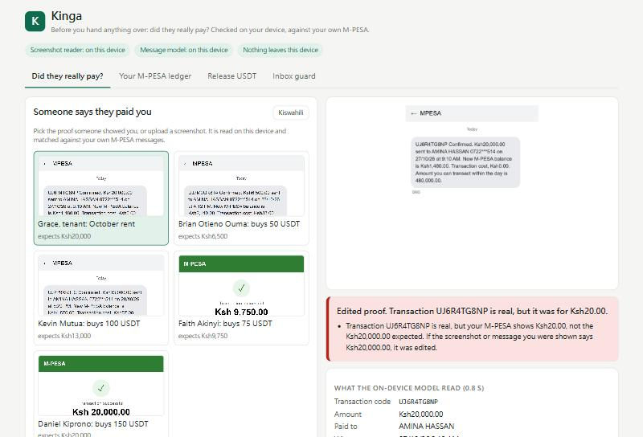
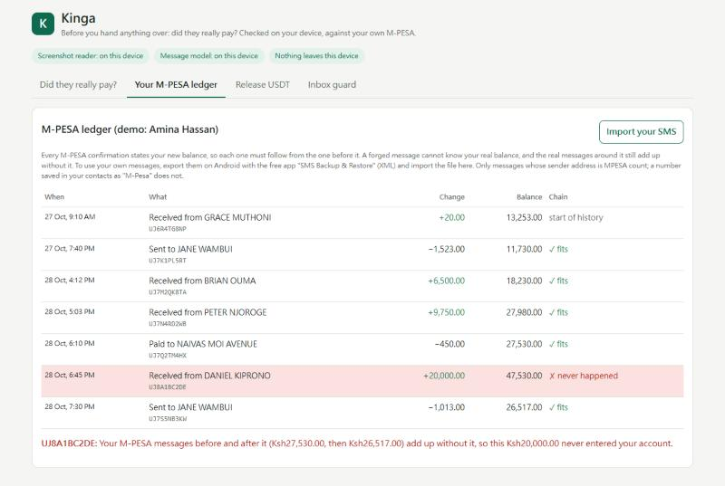
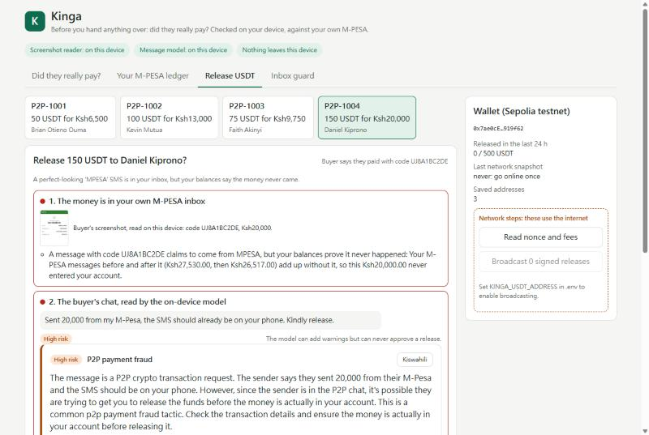

# Kinga

**Before you hand anything over: did they really pay?**

Kinga (Swahili for *protect*) checks M-Pesa payment proofs on your own device, against your own M-PESA messages. Someone shows you a screenshot or says "I paid". An on-device vision model reads the proof, and your own M-PESA messages decide whether that money arrived, how much it was, and who sent it. Nothing leaves the device.

Built for **AI Yako: Own Your AI** (Tether QVAC, Node NBO Nairobi), track **Offline AI apps**.

- **Judges:** [JUDGES.md](JUDGES.md) is one page: run it offline, what to click, where QVAC is used, what needs the internet.
- **Demo video** (recorded with Wi-Fi off): _link to be added_
- Everything here was written during the hackathon, 27 to 30 October 2026 ([what existed before](#what-existed-before)).



---

## The problem

- **The edited real message.** A Nairobi tenant sent her landlady deposits of Sh1 to Sh20, edited the genuine M-PESA texts to read Sh20,000, and kept it up for months. She took Sh129,839 before anyone asked for a full statement ([The Standard, Jun 2025](https://www.standardmedia.co.ke/amp/newsbeat/article/2001522921/nairobi-woman-charged-with-faking-m-pesa-messages-to-defraud-landlady-of-sh130000)). An Embakasi tenant did the same to a caretaker for Sh92,000 ([Oct 2025](https://tnx.africa/newsbeat/article/2001532591/cunning-embakasi-woman-charged-with-forging-m-pesa-rent-payment-texts-worth-sh92000)).
- **Fake payment proofs on P2P.** Sellers on P2P crypto markets are pushed to "release now" on a forged SMS or screenshot ([Streamlinefeed, Aug 2026](https://streamlinefeed.co.ke/news/binance-p2p-kenya-survival-guide-avoid-mpesa-scams)). Safaricom ranks fake confirmations and "I sent it to you by mistake, send it back" among its top scams ([K24, Jul 2026](https://k24.digital/lifestyle/money/safaricom-lists-fake-fuliza-limit-messages-among-top-scams-targeting-m-pesa-users)).
- **Looking at the picture does not work.** On AI-edited receipts, GPT-4o's zero-shot judgment scores AUC 0.509, essentially chance ([AIForge-Doc, arXiv 2602.20569](https://arxiv.org/abs/2602.20569)). People do little better: Kenyans classified 8.6 of 12 messages correctly, and awareness tips only made them flag more genuine ones ([IPA, 2022](https://poverty-action.org/blog/can-you-spot-scam-putting-fraud-attempts-test-kenya)).

The advice is old: don't trust the screenshot, check your own M-PESA. Kinga does that check for you, in two seconds, at the moment someone is pressing you. It is meant for people who get paid by Send Money to a personal number: landlords and caretakers, chama treasurers, people selling on Instagram, WhatsApp or Jiji, and P2P sellers. Businesses with a till already get staff alerts through M-PESA Jumbe.

## How it works: the AI reads, your M-PESA decides

```
 the proof you were shown ──► Qwen3-VL 2B (on device) ──► code, amount, name
                                                               │
 your own M-PESA SMS ──────────────────────────────────────────┤
                                                               ▼
   1. Is a message with that code in your inbox, from the real MPESA sender?   (not a number saved as "M-Pesa")
   2. Is the amount the same?        → if the proof shows more than M-PESA: edited; if both show less: underpaid
   3. Did it come from the person who says they paid?   → if not: triangular fraud
   4. Does its balance fit the balances before and after it?   → if not: almost certainly a forged "MPESA" message
   5. Did it arrive recently?                         → if not: an old payment shown again
                                                               ▼
   paid · edited · underpaid · not in your M-PESA yet · paid by someone else · old payment · balance doesn't follow · fake
```

- **Checks 1 to 3: matching the proof.** These catch every documented attack: a text from a phone number, a forwarded or edited screenshot, an edited real message, or a number saved in the victim's contacts as "M-Pesa".
- **Check 4: the balance chain.** Every genuine M-PESA confirmation states the new balance, so each must follow from the one before. A forger cannot know your real balance, and the genuine messages around a forgery still add up without it. This second layer covers a forged message that sits in your inbox under the real MPESA sender. We found no Kenyan case of that, so we do not claim it is common.
- **Honest outcomes.** Kinga only says what your messages can support:
  - A missing code reads as *not in your M-PESA yet*, never as fake, because M-PESA messages can arrive minutes late.
  - *Fake* needs proof: the code only exists in a message from a phone number. When only the balances speak against a message, it is *almost certainly fake*, with *334# (your real balance) as the deciding check, because a genuine payment next to a missing message of exactly the same amount would look the same.
  - A message from MPESA whose balance does not follow from the one before (a message may be missing) reads as *balance doesn't follow: check *334#*, never as *not there*.
  - *Edited* needs two numbers against M-PESA: what you expected and what the proof shows. If only the model's reading differs, Kinga asks you to compare the picture, because a misread must never accuse anyone. If the proof honestly shows less than you expected, that is *underpaid*.
  - A real payment that arrived more than a day before your latest M-PESA message is flagged as possibly *an old payment shown again*, which Safaricom lists as its own fraud type. A code checked twice is pointed out.
  - Without a readable code there is nothing to look up, so Kinga asks you to type it instead of matching on the amount.
  - *Paid* adds that Safaricom asks the receiver before reversing a payment, so decline such a call unless it really was a mistake. When the payer's name does not match, Kinga suggests forwarding the message to 334, which asks the payer to share their full name (Safaricom, since March 2026).

The models only read and explain; they never decide that money is real:
- **Qwen3-VL 2B** turns a screenshot (SMS or M-PESA app) into a code, amount, name and direction. Rules cannot read pictures.
- **Qwen3 4B** reads messages and P2P chats for pressure and impersonation, and explains verdicts in plain English. It can add a warning, never remove one.

## What you can do in the app

1. **Did they really pay?** Pick a demo proof or upload a screenshot (optionally with the amount you expect and who says they paid). You get one of the outcomes above, with the reason, in English or Kiswahili.
2. **Your M-PESA ledger.** Your MPESA messages as a balance chain; a forgery is marked *never happened*.
   - **Import your own messages:** export them on Android with the free app *SMS Backup & Restore* (XML) and import the file. It stays in memory on this device. Only the raw sender address MPESA counts; a number saved in your contacts as "M-Pesa" does not.
3. **Release USDT** (for people who sell USDT for M-Pesa from their own wallet). The release is signed **offline** only when four checks pass:
   1. The payment proof matches.
   2. The buyer's chat was read by the model, and any warning acknowledged.
   3. The destination is a saved address (look-alikes from address poisoning are blocked).
   4. A Tether WDK wallet policy allows it.

   Broadcasting is a separate, labelled network step.
4. **Inbox guard.** Verdict cards for incoming SMS and WhatsApp messages: the words that triggered each rule are highlighted, and the card tells you what to do (forward to 333, reversals only through 456, check your balance with *334#). Kiswahili mode included. A "sent you money by mistake, send it back" message is proven fake when no such payment ever reached you.

**Demo data** (all synthetic). The seller and landlady is Amina Hassan.

| Proof | What Kinga says |
|---|---|
| Grace, tenant: "Ksh20,000 rent" | **Edited proof.** Transaction UJ6R4TG8NP is real, but it was for Ksh20.00. |
| Brian: buys 50 USDT | **Paid.** The release can be signed offline. |
| Kevin: buys 100 USDT | **Fake.** The code only exists in an SMS from a phone number. |
| Faith: buys 75 USDT | **Paid by someone else** (PETER NJOROGE): triangular fraud. |
| Daniel: buys 150 USDT | **Almost certainly fake.** A perfect-looking "MPESA" SMS is in the inbox, but the balances before and after it add up without it. Check *334#. |

| Ledger | Release USDT |
|---|---|
|  |  |

## Results

**Reading screenshots** (Qwen3-VL 2B, on device). All 5 demo proofs (SMS and app layouts) were read correctly: code, amount and name. Six harder variants of them also read correctly, each giving the right verdict in 0.6 to 2.2 s:
- an upload of the original PNG
- a JPEG at 40% quality, 720 px wide
- a JPEG 480 px wide
- a dark-mode inversion
- a crop of the top third
- the forged app screenshot as a JPEG

Earlier, a 400 px rendering misread Ksh6,500 as 5,000. That is why Kinga looks payments up by **code**; the amount that counts is the one in your M-PESA, and a different amount on the proof is reported as an edit.

**Forged "MPESA" messages: the balance chain** (`npm run eval:ledger`). Each row is 1,000 random, self-consistent histories, each with one forged "you have received" SMS. The forgery has a flawless template and the real MPESA sender, the worst case.

| forger | history | caught by text rules | proved fake by the ledger | any warning | genuine messages warned |
|---|---|---|---|---|---|
| guesses the balance | complete | 0.0% | **100.0%** | 100.0% | 0.0% |
| knows the exact balance | complete | 0.0% | **100.0%** | 100.0% | 0.0% |
| guesses the balance | 10% of SMS missing | 0.0% | 81.4% | 98.9% | 2.7% |
| knows the exact balance | 10% of SMS missing | 0.0% | 82.1% | 91.4% | 3.0% |
| guesses the balance | forgery is the newest message | 0.0% | 0.0% | 100.0% | 0.0% |

- With missing messages, some genuine incoming payments no longer fit the chain. They get *"check your balance before handing anything over"*, never *scam*.
- The newest message cannot be proved fake until the next one arrives, so it gets the same warning.
- [Report](eval/reports/ledger-2026-10-28-14-35.md).

**Message verdicts** (`npm run eval`). The eval set has 210 synthetic Kenyan messages: 126 scams in 14 classes and 84 deliberately hard genuine ones, with 38% in Swahili, Sheng or mixed. A separate agent wrote them without seeing the rule code. Rules were tuned on dev only; the test split was run once with settings frozen. Both models decode greedily (`temp 0`), so the numbers are reproducible.

| mode | dev: scam recall | dev: false positives | **test: scam recall** | **test: false positives** | time per message |
|---|---|---|---|---|---|
| rules only | 97.1% | 0.0% | 75.0% | 2.9% | < 1 ms |
| model only (Qwen3 4B) | 91.4% | 12.0% | 89.3% | 8.8% | 1.2 s |
| **rules + model** | 98.6% | 2.0% | **98.2%** | **8.8%** | 1.3 s |

- Adding the model lifts test recall from 75% to 98%; the cost is more false positives (2.9% to 8.8%).
- On the test split, three genuine messages were flagged:
  - a Fuliza notice written as `Ksh 120.00`
  - a polite P2P buyer
  - a class WhatsApp-group link

  One Swahili betting scam was missed.
- The test split has 34 genuine messages, so one message moves the false-positive rate by about 3 points.
- Reports: [dev](eval/reports/2026-10-28-14-58-dev.md), [test](eval/reports/2026-10-28-15-02-test.md).

**Offline proof** (`npm run offline-proof`). The script starts Kinga, reads all five demo payment proofs on device, runs every demo message and order (including an offline signature), and every 300 ms samples the TCP connections and UDP sockets of every process Kinga starts (Node and QVAC's Bare worker).
- **Simulated offline** (`npm run offline-proof -- --simulate-offline`), for machines whose network cannot be switched off: every Node process of Kinga runs with [`scripts/block-network.cjs`](scripts/block-network.cjs), which makes any TCP, UDP or DNS request beyond this machine fail as it would with Wi-Fi off, and logs it. A self-test first shows a Node process with the same settings cannot reach `https://1.1.1.1`. Result: **PASS**, both models loaded, all five proofs read, **0** refused attempts, **0** TCP connections, **0** UDP sockets ([report](eval/reports/offline-proof-simulated-2026-10-29-13-53.md)). QVAC's Bare worker is not Node, so it is watched rather than blocked.
- With the network on and nothing blocked: **0 outbound connections** ([report](eval/reports/offline-proof-2026-10-29-07-57.md)).
- A `--control` run deliberately uses a network step, and the monitor catches it ([report](eval/reports/offline-proof-control-2026-10-28-13-56.md)).
- `--wait-offline` runs it once Wi-Fi goes off.

## QVAC integration

`@qvac/sdk` **0.22.0**, pinned. Models load from a local cache (`.models/`, set in [`qvac.config.js`](qvac.config.js)) and run fully offline after one download.

| Use | Model constant | Size | Config |
|---|---|---|---|
| Read payment screenshots | `QWEN3VL_2B_MULTIMODAL_Q4_K` + `MMPROJ_QWEN3VL_2B_MULTIMODAL_Q4_K` (Qwen3-VL-2B-Instruct) | 1.11 GB + 0.45 GB | `ctx_size: 4096`, `projectionModelSrc`; image attachment; JSON-schema output; `generationParams: { temp: 0, seed: 7 }` |
| Read messages and chats, explain verdicts | `QWEN3_4B_INST_Q4_K_M` (Qwen3-4B, Q4_K_M) | 2.50 GB | `ctx_size: 4096`; JSON-schema output with the reasoning fields before the category; `temp: 0`; `/no_think` |

- **Files:**
  - [`packages/ai/src/vision.ts`](packages/ai/src/vision.ts): screenshot reader
  - [`packages/ai/src/index.ts`](packages/ai/src/index.ts): message model and prompt
  - [`packages/ai/src/env.ts`](packages/ai/src/env.ts) and [`qvac.config.js`](qvac.config.js): cache location and the worker start-up timeout
  - [`apps/server/src/main.ts`](apps/server/src/main.ts): loads both models; one call at a time
  - [`spikes/`](spikes): model downloads and first experiments
  - [`eval/run.ts`](eval/run.ts): the message eval
- **Measured on the test machine** with both models loaded and used: the QVAC worker process (`bare.exe`) used 4.2 GB of RAM (7.5 GB committed), and the whole GPU showed 6.9 GB in use, including the desktop's own apps. We suggest 16 GB of RAM and a GPU with Vulkan 1.4. CPU-only, macOS and Linux are untested.
- **Why a vision model, not OCR:** proofs arrive as SMS-app screenshots, M-PESA app receipts, dark mode, cropped, or forwarded through WhatsApp, each with a different layout. OCR returns lines of text that would need a hand-written parser per layout; Qwen3-VL returns the six fields Kinga needs (code, amount, counterparty, direction, date, time) as JSON from all of them (see Results). Even so, only the transaction code is used to look the payment up: when you don't say what amount to expect, a different amount on the picture is shown as *check the amount* rather than *edited proof*, because a misread must never accuse anyone.
- **Licences:** Qwen3-4B and Qwen3-VL-2B-Instruct are Apache-2.0 per their model cards. The Swahili-specialised AfriSLM model was not used, because its card lists financial use as out of scope.
- **What did not work:**
  - Qwen3 4B's own Swahili was unusable (repetitive, meaningless sentences). Kiswahili mode therefore shows fixed wording written in advance for every verdict, reason and piece of advice. Model explanations stay in English, and the card says so.
  - A 400 px screenshot rendering misread an amount (see Results).

## Tether WDK (the USDT release)

- **Packages:** `@tetherto/wdk` 1.0.0-beta.22 and `@tetherto/wdk-wallet-evm` 1.0.0-beta.24, on **Sepolia (chainId 11155111)** with test USD₮. `@tetherto/wdk-wallet` is pinned to 1.0.0-beta.21 through npm `overrides`, because the two packages otherwise bring in mismatched copies.
- The WDK instance is created **without a provider**, so it can sign but cannot reach the network.
- `registerPolicy` decodes the ERC-20 calldata. It denies anything that is not a USD₮ transfer, a recipient that is not saved, more than 200 USD₮ per release, and more than 500 USD₮ in any rolling 24 hours. WDK's own policies see only the call arguments and keep no running totals, so Kinga adds both.
- It also denies WDK's own `transfer` and `sendTransaction` outright. `simulate.signTransaction` previews the decision before you confirm.
- **Code:**
  - [`packages/wallet/src/wallet.ts`](packages/wallet/src/wallet.ts): the WDK instance and its policy
  - [`packages/wallet/src/rpc.ts`](packages/wallet/src/rpc.ts): the only code that talks to the chain. It has two explicit steps: read the nonce and fees, and broadcast.
- **Scope:**
  - On Binance P2P the seller releases from exchange escrow; the payment check helps there too, before you tap Release.
  - The on-chain gate is for people who sell from their own wallet.
  - In Kenya, retail USD₮ mostly moves on Tron (TRC-20), and WDK has `wdk-wallet-tron` (with the Shasta testnet), so that is the production target. This build uses Sepolia because its test USD₮ is listed in the WDK docs.

## Features that use the network

Everything not listed here runs offline, which is what the offline proof checks.

1. Downloading the models once (`npm run models:download`, about 4 GB).
2. **Read nonce and fees** (wallet panel): Sepolia JSON-RPC.
3. **Broadcast signed releases** (wallet panel): Sepolia JSON-RPC.
4. `npm install` and building the UI.

## Run it

**Tested on:**
- Windows 11 Home, AMD Ryzen 5 7500F, 48 GB RAM
- NVIDIA RTX 5060 Ti 16 GB, Vulkan 1.4.341
- Node.js 24.12.0

QVAC on Windows needs Vulkan 1.4 or later.

```bash
npm install
```
```bash
npm run models:download
```
```bash
npm run build:web
```
```bash
npm start
```

Then open http://127.0.0.1:8787. Checking payments, the ledger and the inbox guard need nothing else.

**Optional, for the USDT release tab:**

```bash
npm run spike:wdk
```

- It creates a Sepolia test seed in `.env` and never prints it; restart Kinga afterwards. Without it, the Release tab says it is off and everything else works the same. `npm run offline-proof` needs it, because it runs the release flow too.
- To broadcast, also set `KINGA_USDT_ADDRESS` in `.env` to the Sepolia test USD₮ contract and fund the wallet address shown in the app.
- `npm run demo:reset` clears the demo wallet's ledger between rehearsals.

Checks:

```bash
npm test
```
```bash
npm run eval:ledger
```
```bash
npm run eval -- --split test
```
```bash
npm run offline-proof
```

**Troubleshooting.**
- *A model does not load (`RPC_INIT_TIMEOUT` / `WORKER_STARTUP_FAILED`):* this happened once while `npm install` was busy on the same disk, so `qvac.config.js` raises the worker start-up timeout to 120 s. Close heavy disk work and restart.
- *QVAC store errors on Windows:* QVAC issue [#5407](https://github.com/tetherto/qvac/issues/5407) suggests renaming `%USERPROFILE%\.qvac`.

## Repository

```
packages/core     M-PESA receipt parsing, payment-proof matching, the ledger and balance chain, scam signals (S1–S25),
                  risk fusion, address-poisoning checks, SMS Backup & Restore import, Kiswahili wording
packages/ai       QVAC: screenshot reader (Qwen3-VL 2B) and message model (Qwen3 4B)
packages/wallet   WDK release gate: policies, 24 h budget, offline signing, explicit network steps
apps/server       local HTTP service, bound to 127.0.0.1 only
apps/web          Vite + React UI, no external fonts or CDNs
eval/             datasets, eval scripts and reports
scripts/          offline proof, screenshot renderer
spikes/           first experiments and model downloads
docs/             screenshots
```

## Honest limits

- **Synthetic data.** All demo messages, screenshots and the 210-message eval set are synthetic. They were written with AI assistance during development, from public reporting on Kenyan scams. M-PESA message formats come from secondary sources. Kinga has not yet been checked against real 2026 messages, including the new M-PESA Jumbe messages.
- **Clean screenshots.** The screenshots were rendered from HTML. Real phone screenshots will vary more than the variants above.
- **The ledger eval** checks the arithmetic, not the parser. The chain resets after templates it does not model (such as Fuliza auto-repayments), and it cannot prove the newest message fake until the next one arrives.
- **Real money that later goes wrong.** Triangular fraud is caught only when the payer's name can be compared with the buyer's verified name. A genuine payment can still be reversed if the receiver approves it, or after a dispute.
- **Gaps in the history.** The balance chain needs the messages around a payment. With messages missing, a genuine payment can read as *balance doesn't follow* or, rarely, *almost certainly fake*; both point to *334# as the deciding check.
- **Uploaded screenshots** are deleted as soon as the model has read them; only the extracted fields stay, in memory. Imported SMS also stay in memory only.
- **Local service.** Kinga binds to 127.0.0.1 and answers only pages served from this machine (Host and Origin checks), so another website cannot read the inbox or trigger a release.
- **Desktop only.** A phone app would read the M-PESA inbox directly. Google Play restricts SMS access to declared uses such as money management, and QVAC supports Expo. Here, you import an SMS export instead.
- **Kiswahili** wording was written by the developer and still needs review by a native speaker.
- **Testnet only.** Sepolia; never use a seed that holds real funds.

## Third-party components

- **Tether:** QVAC SDK (`@qvac/sdk`, Apache-2.0), WDK (`@tetherto/wdk`, `@tetherto/wdk-wallet-evm`).
- **Models:** Qwen3-4B and Qwen3-VL-2B-Instruct (Alibaba Qwen, Apache-2.0), downloaded through the QVAC registry.
- **UI and tooling:** React 18, Vite 6, TypeScript, tsx. `zod` is pinned to 4.6.6 through npm `overrides` to clear an advisory in QVAC's dependency tree.
- **Research sources:** linked inline above and in [`eval/data/README.md`](eval/data/README.md).

## What existed before

- No code was copied from earlier projects. The LICENSE text and some design principles come from the author's earlier public project Tieout_arc (October 2026, Apache-2.0): a deterministic core as the judge, ambiguous cases left to a person, and reasons recorded as notes.
- The first commit (`85a1449`) is the scaffold. Everything since is hackathon work.
- **AI assistance:** the code, the synthetic data and these docs were written with an AI coding assistant (Claude Code) during the event. The product itself calls no cloud AI; every model runs on the device through QVAC.

## License

Apache-2.0. See [LICENSE](LICENSE).
